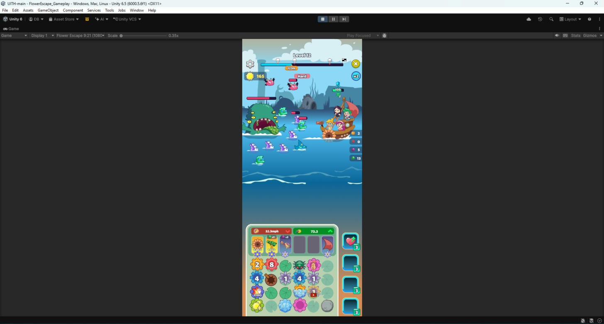
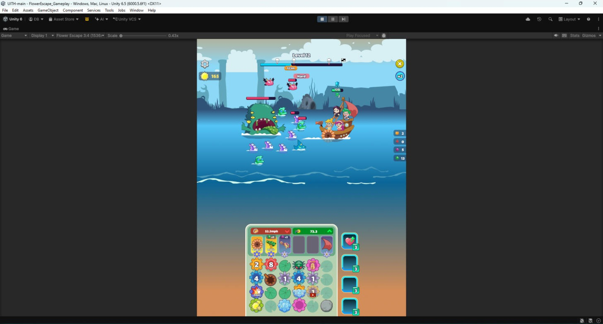
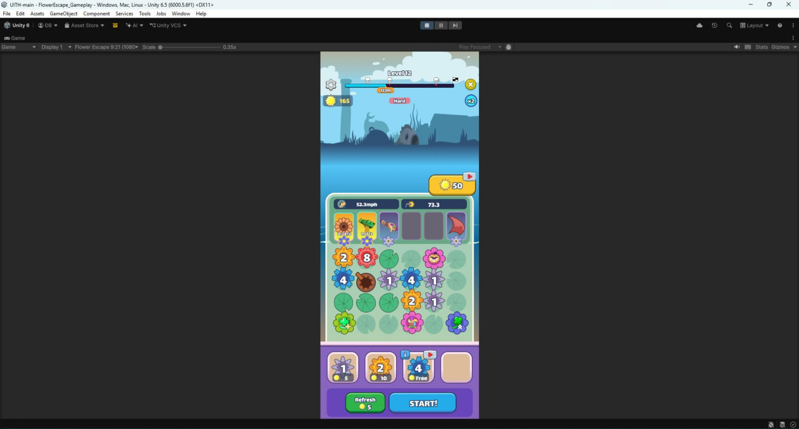
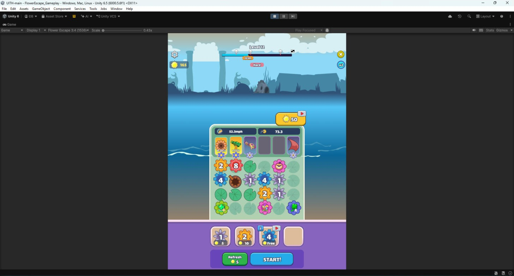

# Flower Escape – Tích hợp UI Figma vào Unity

Bài thực hành môn **Thiết kế giao diện người chơi game** (PTIT)
Sinh viên: **Bùi Tiến Đạt – B24DCGA024**

Unity **6000.5.6f1** (Unity 6.5). Mở bằng Unity Hub, rồi mở scene **`Assets/Scenes/FlowerEscape_Gameplay.unity`**.

## Yêu cầu và cách đáp ứng
| Yêu cầu | Cách làm |
|---|---|
| Tích hợp UI Figma vào Unity | Mỗi lớp trong Figma là một PNG riêng (`Assets/UI/FlowerEscape/Editable`), đặt đúng vị trí trên Canvas uGUI |
| Màn gameplay 2 trạng thái: **combat** và **xếp gear** | `GameplayStateController`: chạm bảng gear → *Xếp gear*, bấm **START!** → *Combat*, Refresh làm các ô gear nảy lên. Khi chuyển trạng thái, màn mờ dần và bảng gear phóng to / thu nhỏ |
| Responsive **9:21** và **3:4** | Canvas Scaler *Scale With Screen Size* 450×1050, chế độ *Expand*. HUD neo theo góc, bảng gear neo đáy, nền lật gương 2 bên cho màn rộng, Safe Area |

Phím tắt khi Play:
- **Space**: đổi trạng thái.
- **1**: về Combat.
- **2**: sang Xếp gear.

Dựng lại scene: **Tools → Flower Escape → Build Gameplay Scene**.
Thêm độ phân giải test: **Tools → Flower Escape → Add Game View Sizes**.

## Ảnh chụp
| | 9:21 (1080×2520) | 3:4 (1536×2048) |
|---|---|---|
| Combat |  |  |
| Xếp gear |  |  |

## Script chính
- `Assets/FlowerEscape_Gameplay/Runtime/GameplayStateController.cs`: chuyển 2 trạng thái.
- `Assets/FlowerEscape_Gameplay/Runtime/SafeArea.cs`: co UI vào vùng an toàn.
- `Assets/FlowerEscape_Gameplay/Runtime/UIPressFeedback.cs`: hiệu ứng nhấn nút.
- `Assets/FlowerEscape_Gameplay/Editor/FlowerEscapeSceneBuilder.cs`: dựng scene từ các lớp ảnh của 2 màn gốc.

Các scene tĩnh gốc vẫn giữ trong `Assets/Scenes` (`FlowerEscape_Main`, `FlowerEscape_BuyGear`, `FlowerEscape_TwoScreens`). Nguồn thiết kế: [Figma](https://www.figma.com/design/bNxsEAwP5cQAH8B696OGb5/).
